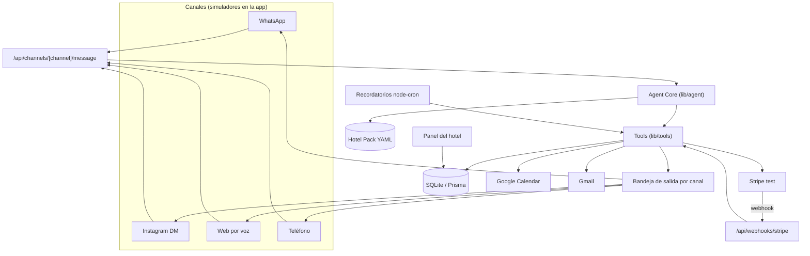

# Brief para Claude Code — Prototipo funcional del Agente Hotelero Omnicanal

> **Para la persona:** guarda este archivo en una carpeta vacía (por ejemplo `agente-hotelero/BRIEF.md`), abre esa carpeta con Claude Code y escríbele: *"Lee BRIEF.md y construye el prototipo siguiendo el plan por fases. Al terminar cada fase, detente, muéstrame cómo probarla y espera mi OK."*
>
> **Para Claude Code:** este documento es la especificación completa. Constrúyelo por fases (sección 17). No avances a la fase siguiente sin que la persona confirme que la anterior funciona. Si algo del brief es ambiguo, pregunta antes de inventar.

---

## 1. Objetivo

Construir una **maqueta funcional** de un asistente hotelero que atiende por cuatro canales con **un solo cerebro** y permite, de punta a punta:

1. **Reservar una habitación** desde cualquiera de los cuatro canales: WhatsApp, Instagram, web por voz y teléfono.
2. **Pagar** con Stripe en modo prueba (tarifa prepago) o dejar la reserva con **pago en el hotel** (garantía al llegar, saldo al salir).
3. **Crear el evento en Google Calendar** del hotel con recordatorios.
4. **Recibir en Gmail un correo HTML bien diseñado** con la confirmación de la reserva.
5. Recibir **recordatorios automáticos** (pre-check-in 24 h antes, aviso el día de salida) en el canal del huésped.
6. Ver todo en un **panel del hotel**: reservas, conversaciones por canal y estado de pagos.

No es producción: los canales de Meta y la telefonía se **simulan** en la propia app (no requieren aprobación de Meta ni números pagados). Los pagos, el calendario y el correo **sí son reales** (con cuentas gratuitas en modo prueba).

**Hotel del demo:** `Kabeli Resort`, San Juan, Puerto Rico (configurable en `hotel-pack.yaml`; para usar "Aura" basta cambiar el nombre ahí).

---

## 2. Qué es real y qué es simulado

| Pieza | En el prototipo | ¿Necesita cuenta? | Costo |
|---|---|---|---|
| Cerebro del agente | Real: Anthropic API con *tool use*. **Modo guiado sin IA** como respaldo (botones) | API key de Anthropic (opcional gracias al modo guiado) | Pago por uso |
| WhatsApp | **Simulador** con aspecto de WhatsApp dentro de la app. Opcional fase 8: Twilio WhatsApp Sandbox real | No (opcional: Twilio trial) | Gratis |
| Instagram / Messenger | **Simulador** de DM dentro de la app | No | Gratis |
| Web por voz | Real en el navegador: Web Speech API (reconocimiento y síntesis de voz de Chrome). Modo texto de respaldo | No | Gratis |
| Teléfono | **Simulador de llamada** (misma voz del navegador con interfaz de llamada). Opcional fase 8: ElevenLabs + Twilio | No (opcional) | Gratis |
| Pagos | Real: **Stripe en modo prueba** (Checkout, tarjetas de prueba, Apple Pay / Google Pay si el dispositivo lo soporta). Respaldo: pantalla de "pago simulado" si no hay claves | Cuenta Stripe gratuita | Gratis |
| Google Calendar | Real: evento en el calendario del hotel con recordatorios | Cuenta Google + proyecto en Google Cloud (OAuth) | Gratis |
| Gmail | Real: envío del correo HTML con Gmail API (mismo OAuth) o, como alternativa, SMTP con contraseña de aplicación | La misma cuenta Google | Gratis |
| Verificación de identidad (Jumio) y firma | **Simulado**: subir foto → resultado "aprobado" tras 2 s; firma con un botón | No | Gratis |
| Base de datos | Real: SQLite local | No | Gratis |

Regla: **cada integración real tiene un respaldo simulado** controlado por variables de entorno. La app debe arrancar y permitir el flujo completo aunque falten todas las claves (con todo en modo simulado).

---

## 3. Stack y comandos

- **Next.js 15 (App Router) + TypeScript** — una sola app con frontend y API.
- **Tailwind CSS** para la interfaz.
- **Prisma + SQLite** (`prisma/dev.db`).
- **@anthropic-ai/sdk** para el agente; modelo por defecto `claude-sonnet-5-5` (variable `LLM_MODEL`).
- **stripe** (SDK de Node) + **Stripe CLI** para webhooks locales.
- **googleapis** para Calendar y Gmail.
- **@react-email/components** + **@react-email/render** para el correo HTML.
- **ics** para adjuntar el evento al correo.
- **node-cron** para los recordatorios, más un botón de "viaje en el tiempo" para probarlos sin esperar.
- **yaml** + **zod** para cargar y validar el Hotel Pack.

Comandos que deben existir en `package.json`:

```bash
npm install
npm run db:reset      # crea la base y carga el seed del hotel
npm run dev           # app en http://localhost:3000
npm run stripe:listen # stripe listen --forward-to localhost:3000/api/webhooks/stripe
npm run test          # pruebas de las herramientas y del flujo
```

---

## 4. Arquitectura



Principios que Claude Code debe respetar:

1. **Un solo core.** Todos los canales llaman a la misma función `handleTurn()`. Ninguna regla de negocio vive en un canal.
2. **Los canales son adaptadores.** Cada simulador solo convierte su entrada a `InboundMessage` y pinta las `parts` de `OutboundMessage` a su estilo.
3. **El modelo nunca inventa precios.** Precios, disponibilidad y políticas salen de las herramientas.
4. **Nunca datos de tarjeta en una conversación.** Todo pago va por enlace de Stripe. Si el usuario escribe algo parecido a una tarjeta, se enmascara antes de guardarlo o enviarlo al modelo.
5. **La reserva prepaga solo se confirma con el webhook de Stripe** (o con el botón de "pago simulado" en modo simulado), nunca porque el huésped diga "ya pagué".
6. **El huésped es uno solo en todos los canales**: se identifica por teléfono o correo.

---

## 5. Estructura de carpetas

```text
app/
  page.tsx                       # Consola omnicanal (los 4 canales lado a lado)
  canal/whatsapp/page.tsx        # Simulador WhatsApp a pantalla completa
  canal/instagram/page.tsx       # Simulador Instagram
  canal/web/page.tsx             # Sitio del hotel con asistente de voz
  canal/telefono/page.tsx        # Simulador de llamada
  panel/page.tsx                 # Panel del hotel: reservas
  panel/conversaciones/page.tsx  # Bandeja por canal con "tomar control"
  panel/reservas/[id]/page.tsx   # Detalle: pagos, eventos, correos, recordatorios
  pago/simulado/[id]/page.tsx    # Respaldo cuando no hay Stripe
  pago/exito/page.tsx            # Vuelta desde Stripe Checkout
  checkin/[token]/page.tsx       # Pre-check-in (foto de documento + firma simuladas)
  api/channels/[channel]/message/route.ts
  api/channels/[channel]/outbox/route.ts   # polling o SSE de mensajes salientes
  api/webhooks/stripe/route.ts
  api/google/auth/route.ts                 # inicio OAuth
  api/google/callback/route.ts
  api/dev/time-travel/route.ts             # adelanta el reloj para probar recordatorios
lib/
  agent/core.ts          # handleTurn(): bucle del modelo con tool use
  agent/prompt.ts        # prompt de sistema desde el Hotel Pack
  agent/guided.ts        # modo guiado sin IA (máquina de estados con botones)
  agent/masking.ts       # enmascarado de tarjetas (Luhn)
  tools/index.ts         # registro y esquemas de herramientas
  tools/availability.ts
  tools/quote.ts
  tools/reservations.ts
  tools/payments.ts      # Stripe o simulado
  tools/calendar.ts      # Google Calendar o simulado
  tools/email.ts         # Gmail o simulado (guarda el HTML en /panel)
  tools/checkin.ts
  tools/services.ts
  tools/folio.ts
  jobs/reminders.ts      # node-cron
  hotel-pack.ts          # carga y valida hotel-pack.yaml
  clock.ts               # reloj del sistema con desplazamiento (time travel)
emails/
  ReservationConfirmed.tsx
  PrecheckinReminder.tsx
  CheckoutReceipt.tsx
prisma/
  schema.prisma
  seed.ts
hotel-pack.yaml
.env.example
BRIEF.md
```

---

## 6. Modelo de datos (Prisma)

```prisma
datasource db { provider = "sqlite"; url = "file:./dev.db" }
generator client { provider = "prisma-client-js" }

model Guest {
  id           String   @id @default(cuid())
  fullName     String?
  email        String?
  phone        String?  // E.164
  language     String   @default("es")
  identities   GuestIdentity[]
  reservations Reservation[]
  createdAt    DateTime @default(now())
}

model GuestIdentity {
  id            String @id @default(cuid())
  guestId       String
  guest         Guest  @relation(fields: [guestId], references: [id])
  channel       String // whatsapp | instagram | web | phone
  channelUserId String
  @@unique([channel, channelUserId])
}

model RoomType {
  id        String @id @default(cuid())
  code      String @unique
  nameEs    String
  nameEn    String
  maxGuests Int
  inventory Int
}

model Reservation {
  id              String    @id @default(cuid())
  code            String    @unique   // KR-20481
  guestId         String
  guest           Guest     @relation(fields: [guestId], references: [id])
  roomTypeCode    String
  ratePlanCode    String    // FLEX | PREPAGO
  paymentMode     String    // prepaid | pay_at_hotel
  checkIn         DateTime
  checkOut        DateTime
  adults          Int
  pets            Int       @default(0)
  status          String    // pending_payment | confirmed | precheckin_done | in_house | checked_out | cancelled | expired
  totalCents      Int
  currency        String    @default("USD")
  createdVia      String    // canal de origen
  holdExpiresAt   DateTime?
  calendarEventId String?
  checkinToken    String?   @unique
  payments        Payment[]
  folioLines      FolioLine[]
  events          ReservationEvent[]
  createdAt       DateTime  @default(now())
}

model Payment {
  id            String   @id @default(cuid())
  reservationId String
  reservation   Reservation @relation(fields: [reservationId], references: [id])
  kind          String   // prepayment | preauth | balance
  provider      String   // stripe | simulated
  externalId    String?  // checkout session o payment intent
  url           String?
  amountCents   Int
  status        String   // link_sent | paid | authorized | captured | released | expired | failed
  createdAt     DateTime @default(now())
}

model FolioLine {
  id            String @id @default(cuid())
  reservationId String
  reservation   Reservation @relation(fields: [reservationId], references: [id])
  concept       String  // room | pet_fee | service | tax
  label         String
  amountCents   Int
  createdAt     DateTime @default(now())
}

model Conversation {
  id        String    @id @default(cuid())
  channel   String
  channelUserId String
  guestId   String?
  mode      String    @default("agent") // agent | staff
  language  String    @default("es")
  messages  Message[]
  updatedAt DateTime  @updatedAt
  @@unique([channel, channelUserId])
}

model Message {
  id             String   @id @default(cuid())
  conversationId String
  conversation   Conversation @relation(fields: [conversationId], references: [id])
  direction      String   // in | out
  partsJson      String   // OutboundMessage.parts o texto entrante (enmascarado)
  toolCallsJson  String?
  delivered      Boolean  @default(false)
  createdAt      DateTime @default(now())
}

model ReservationEvent {
  id            String   @id @default(cuid())
  reservationId String
  reservation   Reservation @relation(fields: [reservationId], references: [id])
  type          String   // created | paid | email_sent | calendar_created | reminder_sent | checkin_done | ...
  detail        String?
  createdAt     DateTime @default(now())
}

model ScheduledReminder {
  id            String   @id @default(cuid())
  reservationId String
  kind          String   // precheckin | checkout_notice | review | hold_expiry
  runAt         DateTime
  sentAt        DateTime?
  @@unique([reservationId, kind])
}
```

**Inventario:** la disponibilidad se calcula contando reservas activas (`pending_payment` con hold vigente, `confirmed`, `precheckin_done`, `in_house`) que se solapan con las fechas, contra `RoomType.inventory`. `create_reservation` debe hacerlo dentro de una transacción para que dos canales no tomen la última habitación a la vez.

---

## 7. Hotel Pack (`hotel-pack.yaml`)

Toda la información del hotel vive aquí. El prompt, el cálculo de precios, el correo y la web se generan desde este archivo. Validarlo con zod al arrancar.

```yaml
hotel:
  nombre: Kabeli Resort
  ciudad: San Juan, Puerto Rico
  zona_horaria: America/Puerto_Rico
  moneda: USD
  telefono: "+1 787 000 0000"
  correo: reservas@kabeliresort.test
  direccion: "[Dirección], Condado, San Juan, Puerto Rico"
  colores: { primario: "#0B6E69", oscuro: "#13302E", arena: "#EFE7DA", acento: "#C2502C", fondo: "#FBF8F3" }
agente:
  nombre: Sol
  tono: cálido, profesional y breve
  idiomas: [es, en]
habitaciones:
  - { codigo: STD_CITY, nombre_es: Estándar Vista Ciudad, nombre_en: Standard City View, max_huespedes: 2, inventario: 10, foto: /img/std.jpg }
  - { codigo: DLX_SEA,  nombre_es: Deluxe Vista al Mar,  nombre_en: Deluxe Ocean View,  max_huespedes: 4, inventario: 8,  foto: /img/dlx.jpg }
  - { codigo: STE_TER,  nombre_es: Suite Terraza,         nombre_en: Terrace Suite,      max_huespedes: 4, inventario: 2,  foto: /img/ste.jpg }
tarifas:
  - codigo: FLEX
    nombre: Flexible (pagas en el hotel)
    modalidad_pago: pay_at_hotel
    garantia_usd: 100
    cancelacion: Gratis hasta 48 h antes; después se cobra la primera noche.
    precio_noche_usd: { STD_CITY: 219, DLX_SEA: 289, STE_TER: 459 }
  - codigo: PREPAGO
    nombre: Prepago (−12%)
    modalidad_pago: prepaid
    descuento_pct: 12
    cancelacion: No reembolsable.
impuestos:
  - { nombre: "Impuesto de habitación (tasa de prueba)", sobre: habitacion, tasa_pct: 9 }   # tasa de prueba, no real
politicas:
  check_in: "15:00"
  check_out: "12:00"
  mascotas: Perros de hasta 10 kg, USD 25 por noche.
  cargo_mascota_usd: 25
  peso_max_mascota_kg: 10
servicios:
  - { codigo: REST, nombre: Restaurante Marea, horario: "18:30-22:30" }
  - { codigo: SPA,  nombre: Spa Arrecife,      horario: "09:00-19:00", precio_usd: 120 }
  - { codigo: TRAS, nombre: Traslado desde el aeropuerto SJU, precio_usd: 45 }
recordatorios:
  precheckin_horas_antes: 24
  aviso_checkout_hora: "08:00"
```

Los precios, impuestos y servicios son **datos de prueba** del demo. Las fotos van en `public/img/` (usar imágenes libres o placeholders de color si no hay).

---

## 8. El agente

### 8.1 Contratos

```ts
type Channel = "whatsapp" | "instagram" | "web" | "phone";

interface InboundMessage {
  channel: Channel;
  channelUserId: string;          // teléfono, @usuario o id de sesión
  text?: string;                  // ya enmascarado
  buttonId?: string;              // respuesta a un botón
  attachment?: { kind: "image"; dataUrl: string };
}

type Part =
  | { type: "text"; text: string }
  | { type: "rate_cards"; items: { roomTypeCode: string; ratePlanCode: string; label: string; totalCents: number; nights: number }[] }
  | { type: "buttons"; items: { id: string; title: string }[] }
  | { type: "payment_link"; url: string; amountCents: number }
  | { type: "image"; url: string; alt: string }
  | { type: "reservation_summary"; reservationCode: string };

interface OutboundMessage { channel: Channel; channelUserId: string; parts: Part[] }
```

Cada canal pinta las `parts` a su estilo: botones de WhatsApp, quick replies de Instagram, tarjetas en la web y **frases habladas** en voz (en voz, `rate_cards` y `payment_link` se convierten en una frase y el enlace se envía al WhatsApp simulado del mismo número, ver 9.4).

### 8.2 `handleTurn()` (modo IA)

1. Enmascarar tarjetas (secuencias de 13 a 19 dígitos que pasen Luhn → `[TARJETA OCULTA]`).
2. Buscar o crear la `Conversation` y el `Guest` (por `channelUserId`; si el huésped da teléfono o correo que ya existe, vincular la identidad).
3. Si `conversation.mode === "staff"`, guardar el mensaje y no responder (lo atiende el panel).
4. Armar el prompt de sistema desde el Hotel Pack (8.3) + últimos 20 mensajes.
5. Llamar al modelo con las herramientas (8.4). Ejecutar cada `tool_use`, devolver el resultado, repetir hasta respuesta final (máximo 6 herramientas por turno).
6. Convertir la respuesta en `OutboundMessage`. Las herramientas pueden devolver `parts` sugeridas (por ejemplo `rate_cards`, `payment_link`) que el core agrega al mensaje.
7. Guardar todo y publicar en la bandeja de salida del canal.

### 8.3 Prompt de sistema (plantilla)

```text
Eres {agente.nombre}, el asistente de {hotel.nombre} en {hotel.ciudad}.
Tono: {agente.tono}. Responde en el idioma del huésped (español o inglés).
Canal: {channel}. Fecha y hora del hotel: {now}.
Reglas:
- Solo hablas de temas del hotel.
- Nunca inventes precios, disponibilidad ni políticas: usa las herramientas.
- Antes de mostrar precios, llama a check_availability y quote.
- Nunca pidas ni repitas datos de tarjeta. Los pagos van por enlace (create_payment_link).
- Para reservar necesitas: fechas, número de personas, mascotas (sí/no), nombre completo, correo y teléfono.
- En voz, habla en frases cortas y no leas URLs: di que enviaste el enlace por WhatsApp.
- Si el huésped pide una persona o está molesto, usa escalate_to_human.
Políticas: check-in {check_in}, check-out {check_out}. Mascotas: {mascotas}.
Tarifas: {lista de tarifas con nombre y cancelación}.
Servicios: {lista de servicios}.
```

### 8.4 Herramientas

Definirlas una vez en `lib/tools/index.ts` con esquema JSON (formato `input_schema` de la Anthropic API) y una función. Las usan tanto el modo IA como el modo guiado.

| Herramienta | Entrada | Hace | Devuelve |
|---|---|---|---|
| `check_availability` | `checkIn`, `checkOut`, `guests`, `pets` | Calcula habitaciones libres | Tipos disponibles |
| `quote` | `roomTypeCode`, `ratePlanCode`, fechas, `guests`, `pets` | Precio por noche × noches, descuento prepago, cargo de mascota, impuesto | `quoteId`, líneas, total, y `parts: rate_cards` |
| `create_reservation` | `quoteId`, `fullName`, `email`, `phone` | Transacción: verifica cupo, crea reserva (`pending_payment` con hold de 30 min si es prepago; `confirmed` si es pago en hotel) | `reservationCode`, `status` |
| `create_payment_link` | `reservationCode`, `purpose` (`prepayment` \| `balance`) | Stripe Checkout Session (o enlace simulado) | `url` y `parts: payment_link` |
| `preauthorize` | `reservationCode` | Checkout Session con `payment_intent_data.capture_method = "manual"` por el monto de garantía | `url` |
| `book_service` | `reservationCode`, `serviceCode`, `datetime` | Crea la reserva del servicio y suma línea al folio si tiene precio | Confirmación |
| `get_folio` | `reservationCode` | Consumos, pagos y saldo | Resumen |
| `start_checkin` | `reservationCode` | Genera `checkinToken` y devuelve el enlace a `/checkin/[token]` | `url` |
| `checkout` | `reservationCode` | Si hay saldo, pide pago; si no, cierra, libera garantía y envía comprobante | Estado |
| `cancel_reservation` | `reservationCode`, `email` | Aplica política de cancelación | Resultado |
| `send_to_whatsapp` | `phone`, `parts` | Publica en la bandeja del WhatsApp simulado de ese número (usado por voz) | `ok` |
| `escalate_to_human` | `reason` | Cambia la conversación a `staff` y la marca en el panel | `ok` |

Ejemplo de esquema:

```json
{
  "name": "quote",
  "description": "Calcula el precio exacto de una habitación y tarifa para unas fechas. Úsala siempre antes de decir un precio.",
  "input_schema": {
    "type": "object",
    "properties": {
      "roomTypeCode": { "type": "string", "enum": ["STD_CITY", "DLX_SEA", "STE_TER"] },
      "ratePlanCode": { "type": "string", "enum": ["FLEX", "PREPAGO"] },
      "checkIn": { "type": "string", "format": "date" },
      "checkOut": { "type": "string", "format": "date" },
      "guests": { "type": "integer", "minimum": 1, "maximum": 4 },
      "pets": { "type": "integer", "minimum": 0, "maximum": 2 }
    },
    "required": ["roomTypeCode", "ratePlanCode", "checkIn", "checkOut", "guests"]
  }
}
```

### 8.5 Modo guiado (sin IA)

Si no hay `ANTHROPIC_API_KEY` (o `AGENT_MODE=guided`), `handleTurn()` usa una máquina de estados con botones que llama a **las mismas herramientas**:

`saludo → fechas (selector o texto "14-16 nov") → personas y mascotas → mostrar habitaciones (rate_cards) → elegir tarifa → pedir nombre, correo y teléfono → crear reserva → pago o confirmación`.

En voz, el modo guiado hace las mismas preguntas en voz alta y entiende respuestas simples (números, "sí", "no", nombres de habitación). Así el demo funciona aunque no haya API key o falle la conexión.

---

## 9. Canales (simuladores)

La página principal `/` es la **Consola omnicanal**: los cuatro canales lado a lado en marcos de teléfono o navegador, para mostrar en vivo que el mismo cerebro atiende todo. Cada canal también tiene su página propia a pantalla completa. Los mensajes salientes llegan por SSE o polling cada segundo desde `/api/channels/[channel]/outbox`.

### 9.1 WhatsApp (simulador)

- Marco de teléfono, cabecera con nombre del hotel y "cuenta de empresa", burbujas, botones bajo los mensajes, envío de imagen (para el check-in).
- Selector arriba: "Hablas como: +1 787 555 0123" (permite simular varios huéspedes).
- Muestra los **recordatorios proactivos** (pre-check-in, aviso de checkout) como mensajes de plantilla, con una etiqueta discreta "Plantilla aprobada (simulada)".
- Fase 8 opcional: adaptador real con **Twilio WhatsApp Sandbox** (`/api/channels/whatsapp/twilio`), detrás de `WHATSAPP_PROVIDER=twilio`.

### 9.2 Instagram DM (simulador)

- Estilo de DM con quick replies. El huésped puede escribir desde una "historia" (tarjeta de promoción arriba).
- Mismo core. Puede ofrecer "pasar a WhatsApp" con un botón que abre el simulador de WhatsApp con la conversación vinculada.

### 9.3 Web por voz (`/canal/web`)

- Sitio del hotel (inicio, habitaciones, servicios, políticas) generado desde el Hotel Pack, con un **asistente de voz flotante**.
- Botón grande "Hablar con Sol": usa `window.SpeechRecognition || window.webkitSpeechRecognition` (idioma `es-US` o `en-US` según el huésped) para escuchar y `speechSynthesis` para responder.
- Mientras habla, muestra la **transcripción en vivo** y las `parts` visuales (tarjetas de tarifa, botón de pago). El pago es un **botón en pantalla**, nunca dictado.
- Botón "Prefiero escribir" para el modo texto.
- Si el navegador no soporta reconocimiento de voz, avisar y pasar a texto.

### 9.4 Teléfono (simulador de llamada)

- Interfaz de llamada: "Llamando a Kabeli Resort…", temporizador, botones de silencio y colgar, transcripción en vivo.
- Antes de "llamar", el usuario indica su número (para el traspaso a WhatsApp).
- Mismo motor de voz del navegador. Al llegar al pago, el agente dice "te envié el enlace de pago por WhatsApp" y llama a `send_to_whatsapp`: **el enlace aparece en el simulador de WhatsApp del mismo número**, en vivo, mientras la llamada sigue.
- Fase 8 opcional: agente real de ElevenLabs con *server tools* apuntando a `/api/tools/[name]` y número de Twilio.

---

## 10. Pagos (Stripe en modo prueba)

**Prepago (`PREPAGO`):**

1. `create_reservation` crea la reserva en `pending_payment` con `holdExpiresAt = now + 30 min`.
2. `create_payment_link` crea una **Checkout Session** (`mode: "payment"`) con `metadata.reservationCode`, `success_url = /pago/exito?code=...`, `expires_at` a 30 minutos. Guarda un `Payment` en `link_sent`.
3. El huésped paga con una tarjeta de prueba (`4242 4242 4242 4242`, cualquier fecha futura y CVC).
4. El webhook `checkout.session.completed` (verificado con `STRIPE_WEBHOOK_SECRET`) marca el pago `paid`, la reserva `confirmed` y dispara: **correo de confirmación**, **evento en Google Calendar**, **programación de recordatorios** y un mensaje en el canal de origen ("¡Pago recibido! Te envié la confirmación a tu correo").
5. Si vence el hold sin pago, un job pasa la reserva a `expired`.

**Pago en el hotel (`FLEX`):**

1. La reserva queda `confirmed` sin cobro → mismo correo, evento y recordatorios.
2. En el pre-check-in se pide la **garantía**: Checkout Session con `payment_intent_data.capture_method = "manual"` por `garantia_usd`. El webhook marca `authorized`.
3. Durante la estadía, `book_service` suma líneas al folio.
4. En el checkout, `create_payment_link(purpose: "balance")` cobra el saldo; al pagarse, se **cancela** el PaymentIntent de garantía (`paymentIntents.cancel`) y se envía el comprobante por correo.

**Modo simulado** (sin `STRIPE_SECRET_KEY`): el enlace apunta a `/pago/simulado/[id]`, una página con aspecto de checkout y un botón "Pagar (simulado)" que dispara exactamente la misma lógica que el webhook.

Nunca guardar ni registrar datos de tarjeta: solo el ID de la sesión y el estado.

---

## 11. Google Calendar

- OAuth 2.0 con la cuenta Google del hotel (ver 16.2). Scopes: `https://www.googleapis.com/auth/calendar.events` y `https://www.googleapis.com/auth/gmail.send`. Guardar el refresh token en `.data/google-token.json` (en `.gitignore`).
- Al confirmarse una reserva, crear un evento en `GOOGLE_CALENDAR_ID` (o `primary`):
  - **Título:** `🛎 KR-20481 · Camila Rojas · Deluxe Vista al Mar`
  - **Inicio / fin:** check-in 15:00 y check-out 12:00 en `America/Puerto_Rico` (evento de varios días).
  - **Descripción:** huéspedes, mascotas, tarifa, modalidad de pago, estado del pago, canal de origen, teléfono y correo, enlace al detalle en el panel.
  - **Color:** según estado (por ejemplo verde si está pagada, amarillo si es pago en hotel).
  - **Recordatorios:** `reminders.useDefault = false`, `overrides: [{ method: "popup", minutes: 1440 }, { method: "email", minutes: 1440 }, { method: "popup", minutes: 60 }]`.
  - **Invitado opcional:** el correo del huésped (`attendees`), con `sendUpdates: "none"` para no duplicar el correo de confirmación. Configurable con `CALENDAR_INVITE_GUEST=true`.
- Al cancelar, borrar o marcar el evento como cancelado. Al modificar, actualizarlo.
- **Modo simulado** (sin token): guardar el evento en `ReservationEvent` y mostrarlo en el panel como "Evento de calendario (simulado)".

---

## 12. Correo HTML de confirmación

Enviar con Gmail API (`users.messages.send` con MIME `multipart/alternative` + adjunto `.ics`) desde la cuenta conectada. Alternativa: Nodemailer por SMTP de Gmail con contraseña de aplicación (`EMAIL_PROVIDER=smtp`). **Modo simulado:** guardar el HTML y mostrarlo en el panel (pestaña "Correos").

Construir con **React Email** (`emails/ReservationConfirmed.tsx`), en el idioma del huésped. Debe verse bien en Gmail web y móvil (ancho máximo 600 px, tablas de React Email, sin CSS externo, imágenes con `alt`).

**Diseño:**

- Colores del Hotel Pack: fondo arena `#EFE7DA`, tarjeta blanca con bordes redondeados, verde laguna `#0B6E69` para botones, texto `#13302E`.
- Tipografía: Georgia (títulos, serif) y Helvetica/Arial (texto).
- **Encabezado:** nombre del hotel a la izquierda y código de reserva a la derecha.
- **Imagen principal** de la habitación reservada (URL pública; en local usar `APP_PUBLIC_URL` o un placeholder).
- **Título:** "Tu reserva está confirmada, {nombre}." + una línea cálida ("Te esperamos el sábado 14 de noviembre").
- **Tabla de detalles:** fechas y noches, habitación, huéspedes y mascotas, tarifa y política de cancelación, estado del pago (Pagado / Pagas en el hotel).
- **Desglose:** noches × precio, descuento, cargo de mascota, impuestos, **total** destacado.
- **"Lo que sigue":** "24 h antes te escribiremos por WhatsApp para tu check-in digital" + horarios de check-in y check-out.
- **Dos tarjetas de servicios** (restaurante y traslado) con enlace a reservar por WhatsApp.
- **Botones:** "Agregar a mi calendario" (adjunto `.ics` + enlace de Google Calendar `https://calendar.google.com/calendar/render?action=TEMPLATE&...`) y "Escríbenos por WhatsApp".
- **Firma:** "Sol, asistente de Kabeli Resort, en nombre de todo el equipo" + teléfono, correo y dirección.
- **Pie:** política de privacidad (texto corto) y aviso de que el pago se procesó de forma segura con Stripe.
- **Asunto:** `✅ Reserva confirmada · Kabeli Resort · 14–16 nov · KR-20481` (y versión en inglés).

Otros correos con el mismo diseño: `PrecheckinReminder` (24 h antes, con botón al pre-check-in) y `CheckoutReceipt` (comprobante con consumos, impuestos y pagos).

Agregar en el panel un botón **"Vista previa del correo"** para ver el HTML sin enviarlo.

---

## 13. Recordatorios

- Al confirmarse una reserva, crear `ScheduledReminder`:
  - `precheckin`: check-in − 24 h → mensaje en el canal del huésped (WhatsApp si tiene teléfono) con botón "Hacer pre-check-in" + correo `PrecheckinReminder`.
  - `checkout_notice`: día de salida a las 08:00 → resumen de cuenta y botón para pagar el saldo (si es pago en hotel).
  - `review`: checkout + 24 h → "¿Cómo estuvo tu estadía?" con botones 1 a 5.
  - `hold_expiry`: `holdExpiresAt` → expira la reserva si sigue sin pago.
- `node-cron` revisa cada minuto los recordatorios vencidos según `lib/clock.ts`.
- **Viaje en el tiempo** (solo en desarrollo): en el panel, botones "Adelantar a 24 h antes del check-in", "Adelantar al día de salida" y "+1 hora". Mueven el desplazamiento del reloj y ejecutan el chequeo al instante, para demostrar los recordatorios en vivo.
- Los recordatorios de Google Calendar (sección 11) son adicionales y los envía Google.

**Pre-check-in (`/checkin/[token]`):** página móvil con texto de consentimiento ("Acepto" / "Prefiero hacerlo en recepción"), subida de foto del documento (no se guarda la imagen: se descarta tras "verificar"), resultado "Identidad verificada (simulado)" a los 2 s, firma de condiciones con un botón y, si la tarifa es pago en hotel, el botón de garantía. Al terminar: reserva `precheckin_done` y mensaje en WhatsApp con "Habitación 412, lista desde las 15:00".

---

## 14. Panel del hotel

- **`/panel`**: tabla de reservas con código, huésped, fechas, habitación, tarifa, canal de origen (ícono), estado de la reserva y del pago, enlace a Google Calendar si existe. Filtros por estado y canal. Contadores simples arriba (reservas de hoy, pagos pendientes).
- **`/panel/reservas/[id]`**: línea de tiempo de `ReservationEvent` (creada, enlace enviado, pagada, correo enviado, evento creado, recordatorios), pagos, folio, vista previa de correos, botones de cancelar y de viaje en el tiempo.
- **`/panel/conversaciones`**: lista de conversaciones de los cuatro canales; al abrir una, se ve el historial con las llamadas a herramientas desplegables; botones "Tomar control" (el staff escribe y el agente se calla) y "Devolver al agente".
- Indicadores de integraciones arriba: Anthropic, Stripe, Google (real / simulado), para saber qué está conectado durante el demo.

---

## 15. Pantallas y diseño

Identidad del Hotel Pack: fondo `#FBF8F3`, verde laguna `#0B6E69`, oscuro `#13302E`, arena `#EFE7DA`, coral `#C2502C` (solo acentos). Títulos con una serif (por ejemplo *Young Serif* o *Fraunces* de Google Fonts) y texto con *Manrope* o *Inter*. Todo responsive.

| Ruta | Pantalla |
|---|---|
| `/` | Consola omnicanal: 4 marcos (WhatsApp, Instagram, web por voz, teléfono) + barra con estado de integraciones |
| `/canal/web` | Sitio del hotel con asistente de voz flotante |
| `/canal/whatsapp`, `/canal/instagram`, `/canal/telefono` | Cada simulador a pantalla completa |
| `/pago/simulado/[id]`, `/pago/exito` | Pago simulado y retorno de Stripe |
| `/checkin/[token]` | Pre-check-in móvil |
| `/panel`, `/panel/reservas/[id]`, `/panel/conversaciones` | Panel del hotel |

---

## 16. Configuración

### 16.1 `.env.example`

```bash
APP_PUBLIC_URL=http://localhost:3000

# Agente
AGENT_MODE=ai                 # ai | guided
ANTHROPIC_API_KEY=
LLM_MODEL=claude-sonnet-5-5

# Stripe (modo prueba)
STRIPE_SECRET_KEY=sk_test_...
STRIPE_WEBHOOK_SECRET=whsec_...

# Google (OAuth)
GOOGLE_CLIENT_ID=
GOOGLE_CLIENT_SECRET=
GOOGLE_REDIRECT_URI=http://localhost:3000/api/google/callback
GOOGLE_CALENDAR_ID=primary
CALENDAR_INVITE_GUEST=false

# Correo
EMAIL_PROVIDER=gmail          # gmail | smtp | simulated
EMAIL_FROM_NAME=Kabeli Resort
SMTP_USER=
SMTP_APP_PASSWORD=

# Canales opcionales (fase 8)
WHATSAPP_PROVIDER=simulated   # simulated | twilio
TWILIO_ACCOUNT_SID=
TWILIO_AUTH_TOKEN=
TWILIO_WHATSAPP_FROM=
VOICE_PROVIDER=browser        # browser | elevenlabs
ELEVENLABS_API_KEY=
ELEVENLABS_AGENT_ID=

# Desarrollo
ENABLE_TIME_TRAVEL=true
```

Si una clave falta, esa integración pasa sola a modo simulado y el panel lo muestra.

### 16.2 Guía de cuentas (Claude Code debe incluirla en el README)

**Stripe:** crear cuenta gratuita → activar *modo de prueba* → copiar la clave secreta de prueba → instalar Stripe CLI → `stripe login` → `npm run stripe:listen` y copiar el `whsec_...` que imprime.

**Google Calendar y Gmail:**
1. Crear un proyecto en Google Cloud Console.
2. Habilitar *Google Calendar API* y *Gmail API*.
3. Configurar la pantalla de consentimiento OAuth en modo *Testing* y agregar la cuenta Google del hotel como usuario de prueba.
4. Crear credenciales *OAuth client ID* de tipo *Web application* con el redirect `http://localhost:3000/api/google/callback`.
5. Copiar Client ID y Secret al `.env`, abrir `http://localhost:3000/api/google/auth` y autorizar.

**Anthropic (opcional):** crear una API key y copiarla. Sin ella, el agente funciona en modo guiado.

---

## 17. Plan de construcción por fases

Al terminar cada fase: correr las pruebas, explicar a la persona cómo verificarla en el navegador y esperar su OK.

| Fase | Entregable | Cómo se verifica |
|---|---|---|
| 1 | Proyecto Next.js, Prisma con seed, carga del Hotel Pack, herramientas de disponibilidad, cotización y reserva con pruebas | `npm run test` pasa; dos reservas simultáneas de la última habitación: una gana y la otra recibe "sin disponibilidad" |
| 2 | `handleTurn()` en modo guiado + simulador de WhatsApp + panel de reservas | Reservar por WhatsApp de punta a punta con pago simulado y verla en `/panel` |
| 3 | Modo IA con Anthropic y las mismas herramientas | La misma reserva conversando en lenguaje natural, en español y en inglés |
| 4 | Stripe real (prepago y pago en hotel) con webhooks | Pagar con `4242…`; la reserva pasa a `confirmed` solo cuando llega el webhook |
| 5 | Google Calendar + correo HTML con React Email + `.ics` | Al pagar llega el correo a Gmail y aparece el evento con recordatorios en el calendario |
| 6 | Instagram, web por voz y teléfono; traspaso voz → WhatsApp; consola omnicanal | Reservar por voz en la web; llamar, reservar y ver llegar el enlace al WhatsApp simulado |
| 7 | Recordatorios con viaje en el tiempo, pre-check-in, servicios, folio, checkout y bandeja con "tomar control" | Adelantar el reloj y ver el pre-check-in; hacer checkout con saldo y recibir el comprobante |
| 8 (opcional) | Twilio WhatsApp Sandbox y ElevenLabs reales | Mismo flujo desde un WhatsApp real |

---

## 18. Guion del demo (criterio final de aceptación)

1. Abrir `/` con los cuatro canales a la vista.
2. **Web por voz:** "Hola, quiero dos noches del 14 al 16 de noviembre para dos personas y un perro pequeño" → el agente responde con las dos tarifas en pantalla → "La prepago" → pide nombre, correo y teléfono → aparece el botón de pago → pagar con `4242…`.
3. Mostrar en vivo: la reserva `confirmed` en el panel, **el correo HTML en Gmail** y **el evento en Google Calendar** con sus recordatorios.
4. **Teléfono:** llamar con otro número, reservar la Estándar con tarifa Flexible → el agente dice que envió el enlace por WhatsApp → el mensaje aparece en el WhatsApp simulado de ese número.
5. **Instagram:** preguntar "¿aceptan perros de 12 kg?" → responde según la política (no) y ofrece alternativas.
6. **Viaje en el tiempo** a 24 h antes del check-in → llega el recordatorio por WhatsApp → completar el pre-check-in.
7. Pedir el spa por WhatsApp → se suma al folio → adelantar al día de salida → pagar el saldo → llega el comprobante por correo.
8. En `/panel/conversaciones`, tomar el control de una conversación y responder como staff.

Si todo el guion funciona sin intervención manual en la base de datos, el prototipo está terminado.

---

## 19. Reglas para Claude Code

- No subir secretos al repositorio: `.env`, `.data/` y `prisma/dev.db` van en `.gitignore`.
- Nunca pedir, registrar ni guardar datos de tarjeta; pruebas automáticas que lo verifiquen (mensaje con `4242 4242 4242 4242` → se guarda enmascarado y el agente no lo repite).
- Las herramientas recalculan todo desde la base: ignorar cualquier precio que venga del modelo o del usuario.
- Todo texto al huésped en español o inglés según su idioma.
- Cada integración real con su respaldo simulado y un indicador visible en el panel.
- Mantener un `README.md` con instalación, configuración de cuentas (16.2) y el guion del demo.
- Si una decisión no está en este brief, preguntar a la persona antes de implementarla.
